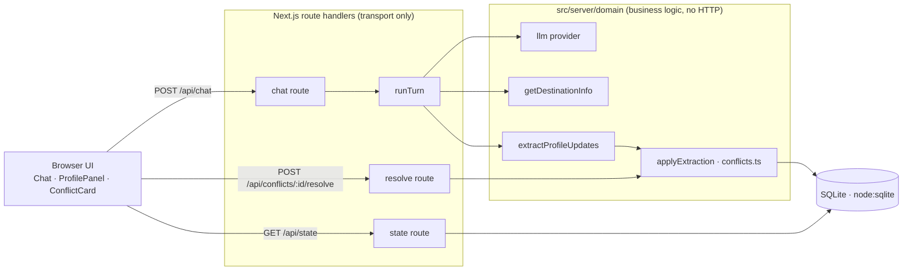

# Profile Builder — Plan v1.3

Status: approved for build · Budget: ~2 hours · Supersedes: *Travel Identity Agent Design Review v1.2.0*

Profile Builder is a single-page app where a traveler chats with an assistant, and the assistant builds a durable
travel profile from the conversation. This plan keeps v1.2.0's core thesis — **prove the core loop with the fewest
moving parts** — and fixes the gaps found when reviewing it against the assignment.

---

## 0. What changed from v1.2.0

| # | v1.2.0 | Problem | v1.3 |
|---|---|---|---|
| 1 | "Don't create the repo until Step D" | Commit history is the second-most-weighted deliverable; it can't be reconstructed later | `git init` before the first line of code; one commit per checkpoint, messages explain *why*. Push to GitHub at the end. |
| 2 | Deterministic match against the hardcoded destinations | Unknown destinations never reach `getDestinationInfo`, so the `null` path never runs and the model talks freely (hallucination risk). False positives ("Georgia"), misses ("Kyoto, Japan") | **Native tool calling** in the streamed chat call. Name normalization/aliases live *inside* `getDestinationInfo`. `null` → explicit "no data" tool result. |
| 3 | "Client refetches profile after the turn" | Extraction finishes after the text stream; a refetch can race it and show the stale profile | Extraction runs before the response closes; the **final stream event carries the updated profile + conflicts**. No refetch. |
| 4 | Extraction sees only the newest user message | "Are you vegetarian?" → "Yes" extracts nothing | Extraction sees the current profile + the **previous assistant message** + the new user message. |
| 5 | Profile fields never defined | It's an explicit "your call" in the brief | Schema defined in §3 with the rationale for each field. |
| 6 | Conflicts detected only by the LLM; no resolution | Not localized; user can never change their mind | LLM *proposes*; one module, `conflicts.ts`, *decides* using clear rules. **Keep / Replace** buttons, and the assistant raises open conflicts on the next turn. |
| 7 | Provider config / failure modes absent | Explicitly evaluated | §8: env-configured provider + model, typed error codes, UI states for missing/invalid key, plus a `mock` provider. |
| 8 | Zod for API + model output only | Persisted data is also a runtime boundary | Zod-parse rows when they're read from SQLite. |
| 9 | No testing strategy | — | §10: Vitest unit tests on the risky logic, Playwright E2E against a deterministic mock model, an on-demand live eval, and GitHub Actions CI. |
| 10 | Process deliverables not budgeted | They're what reviewers read most carefully | PROCESS.md notes drafted *during* the build; time reserved in §11. |
| 11 | Travel Identity traits in V0 | Not required; costs ~15 min | **Cut from the 2h budget** → listed under "With another day". |
| 12 | SQLite driver unspecified | `better-sqlite3` is a native module; on Node 26/Windows it may need a C++ toolchain → breaks "running in 5 minutes" | Built-in **`node:sqlite`** (no native dependencies). Requires Node ≥ 22.13; set in `engines`. |

Kept from v1.2.0 unchanged: two-call orchestration (stream reply, then extract), direct SQLite with no ORM,
one schemas module, the deferred-infrastructure list, checkpoint-driven delivery.

---

## 1. Scope

**In:** streamed chat · tool-called destination lookups · structured extraction · SQLite persistence (messages,
profile, conflicts) · read-only profile panel · conflict surfacing and resolution · typed API · env-configured
provider + mock · JSON logs · unit + E2E tests + CI · small live eval · README + PROCESS.md.

**Out (per brief):** auth or multiple users, real travel APIs, mobile polish, bookings or sharing.

**Out (our cut):** travel-identity traits, live profile updates *during* streaming (the profile updates at the end of
each turn), profile history/timeline, conflict-detection confidence scoring, cross-tab sync.

### Assumptions (recorded per the brief's instructions)
- **Single user, single profile.** A "Start over" action clears everything (also used by tests).
- **Explicit correction ≠ contradiction.** "Actually, I eat meat now" updates the field directly (the user stated a
  change). An *implicit* contradiction (vegetarian earlier, now "book us a steakhouse") creates a conflict and keeps the old value.
- **Interview-style assistant.** It asks one focused follow-up at a time, aimed at the most valuable missing field,
  and reflects back what it learned. It never drafts fields the user didn't say. (A draft-then-correct approach invites
  hallucinated profile data, which is exactly what the brief probes for.)
- Destination data from `getDestinationInfo` is the *only* source of destination facts.

---

## 2. Architecture



**Layering rule:** route handlers parse and validate input, call one domain function, and serialize the result. The domain
never imports `next/*`. UI components never import server code — only `src/shared/contract.ts`.

### File tree
```
profile-builder/
├── README.md · PROCESS.md · .env.example
├── docs/PLAN.md                     # this file
├── transcripts/                     # exported agent sessions, labeled
├── .github/workflows/ci.yml
├── data/                            # gitignored; profile.db created on first run
├── src/
│   ├── shared/
│   │   └── contract.ts              # zod schemas + inferred types shared by client & server
│   ├── server/
│   │   ├── config.ts                # env parsing (zod) → typed config, fail-fast messages
│   │   ├── log.ts                   # JSON-lines logger
│   │   ├── db.ts                    # node:sqlite, schema init, repositories (validated reads)
│   │   ├── llm/
│   │   │   ├── provider.ts          # openai | mock selection
│   │   │   ├── mock.ts              # scripted model for tests / keyless demo
│   │   │   └── prompts.ts           # system prompt builder (profile + open conflicts)
│   │   └── domain/
│   │       ├── turn.ts              # runTurn: the lifecycle in §5
│   │       ├── destinations.ts      # data + getDestinationInfo + tool definition
│   │       ├── extraction.ts        # structured extraction call + validation
│   │       └── conflicts.ts         # applyExtraction / resolveConflict — pure functions
│   ├── app/
│   │   ├── page.tsx · layout.tsx
│   │   └── api/{chat,state,conflicts/[id]/resolve,reset}/route.ts
│   └── components/
│       ├── Chat.tsx · ProfilePanel.tsx · ConflictCard.tsx · ErrorBanner.tsx
├── tests/
│   ├── unit/                        # vitest
│   └── e2e/                         # playwright
└── evals/                           # live extraction eval (on demand)
```

**Layout:** two columns — the chat (≈60%) on the left, a sticky profile panel on the right. Conflict cards are pinned at the
top of the panel, because that's where the user looks to check what the assistant believes. It doesn't break at narrower
widths (the columns stack); no further responsive work.

---

## 3. Travel profile schema

Each field stores `{ value, evidence, updatedAt }`, where `evidence` is the user's own words that produced it. Showing
the evidence in the panel lets the user audit extractions, and makes conflicts explainable.

| Field | Type | Why it belongs on a *durable* profile |
|---|---|---|
| `homeBase` | string | Shapes flight length, visas, and seasonality; rarely changes |
| `budgetTier` | `budget \| midRange \| luxury` | Maps 1:1 to `averageDailyBudgetUSD` from the tool |
| `travelPace` | `relaxed \| balanced \| packed` | Most predictive of trip satisfaction; destination-independent |
| `companions` | `solo \| partner \| family \| friends` | Changes every downstream suggestion |
| `tripLength` | `weekend \| oneWeek \| twoWeeks \| longer` | Bucketed, because exact dates are trip-specific, not profile data |
| `preferredSeasons` | season[] | Matches the tool's `bestSeasons` |
| `accommodation` | string[] (e.g. boutique, hostel, rental) | Stable personal preference |
| `interests` | string[] | Matches the tool's `knownFor` → informed follow-ups |
| `dislikes` | string[] | Equally predictive; also a cross-field conflict source |
| `dietary` | string[] | High-cost if wrong; the brief's canonical conflict example |
| `accessibility` | string | Hard constraint; never inferred, only stated |
| `destinationsOfInterest` | `{ name, status: wishlist \| visited }[]` | Destinations are signals of *why* someone travels |

**Deliberately excluded:** dates, passport or ID numbers, loyalty numbers (trip-specific or sensitive; not "preferences").

---

## 4. API contract (`src/shared/contract.ts`)

All shapes are zod schemas; TypeScript types are inferred from them (`z.infer`), so client and server can't drift.

| Endpoint | Request | Response |
|---|---|---|
| `GET /api/state` | — | `AppState = { messages: ChatMessage[], profile: TravelProfile, conflicts: Conflict[] }` |
| `POST /api/chat` | `ChatRequest = { message: string (1..2000) }` | **UI message stream** (AI SDK): text deltas · tool-call/result parts (`getDestinationInfo`) · final `data-turn` part = `TurnResult` |
| `POST /api/conflicts/:id/resolve` | `ResolveRequest = { choice: 'keep' \| 'replace' }` | `{ profile, conflicts }` |
| `POST /api/reset` | — | `AppState` (empty) |
| any error | — | `ApiError = { code: 'llm_not_configured' \| 'llm_auth_failed' \| 'llm_unavailable' \| 'invalid_request' \| 'internal', message: string }` |

`TurnResult = { profile, conflicts, extraction: 'applied' | 'no_changes' | 'failed' }` — so the UI can show
"Couldn't update your profile from that message" without failing the chat.

**Conversation history is server-owned:** the client sends only the new message, and the server loads history from
SQLite. That's one source of truth, and the client can't inject fake history.

`Conflict = { id, field, existingValue, candidateValue, evidence, reason, status: 'open' | 'kept' | 'replaced', createdAt }`

---

## 5. Turn lifecycle (`runTurn`)

1. Validate `ChatRequest`; persist the user message.
2. Build the system prompt: assistant persona + interview policy + **current profile** + **open conflicts** ("Ask the
   user about these before moving on").
3. `streamText` with the tool `getDestinationInfo({ name })` and a multi-step limit (≤3 steps: lets the model call the tool
   and then keep writing). The model is instructed to call the tool for *every* specific destination mentioned.
4. Stream text and tool parts to the client as they arrive.
5. On finish: persist the assistant message (text + tool-call summaries, so the "looked up Kyoto" chip survives a reload).
6. `extractProfileUpdates(profile, previousAssistantMsg, userMsg)` → `ExtractionResult` (§7).
7. `applyExtraction(profile, openConflicts, result)` → `{ profile, newConflicts }`; persist both in one transaction.
8. Write the final `data-turn` part; close the stream.

**Failure handling per step**

| Failure | Behavior |
|---|---|
| Missing key | `/api/chat` → 503 `llm_not_configured` before streaming; the UI shows a setup banner with the env var name. The rest of the app (profile, history) still loads. |
| Invalid key (401) | `llm_auth_failed` → banner: "OpenAI rejected the API key". |
| Rate limit / timeout / 5xx | One retry where the SDK allows it, else `llm_unavailable` → inline "Retry" on the failed message. The user message is already saved. |
| Stream dies mid-reply | Persist the partial text, marked `interrupted`; skip extraction for that turn. |
| Tool throws | Return `{ found: false, error }` to the model (treated like `null`); log it. |
| Extraction invalid after 1 retry | `extraction: 'failed'`; profile untouched; logged. Chat unaffected. |

---

## 6. Destination tool

```ts
async function getDestinationInfo(name: string): Promise<DestinationInfo | null>
```
- **6 destinations:** Kyoto, Paris, Mexico City, Reykjavík, Marrakech, Bangkok. Schema as specified, extended with
  `highlights: string[]` (2–3 concrete things to ask about) — the spec's fields and the function name are unchanged.
- Lookup normalizes case, accents, and suffixes (`"kyoto, japan"`, `"Reykjavik"`) via an alias map. Anything else → `null`.
- The tool wrapper returns `{ found: true, info }` or `{ found: false, name }`. The prompt rule for `found: false`: *don't
  state facts about the place; say you don't have data on it, and ask what draws them there.*
- **How the result threads back:** the tool result is part of the same multi-step generation, so the model's follow-up
  question is written *after* it has read `bestSeasons`, `knownFor`, and the budget. The prompt asks it to connect at least one
  tool fact to a profile gap (e.g. `bestSeasons` vs. an unknown `preferredSeasons`; the budget tier vs. a missing `budgetTier`).

---

## 7. Extraction

- `generateObject` with a zod schema (OpenAI structured outputs, strict mode → the schema uses nullable fields, not optional ones).
- Input: the current profile, the previous assistant message, the new user message.
- Output `ExtractionResult`:
  ```ts
  {
    updates: Array<{ field, op: 'set' | 'add' | 'remove', value, evidence, explicitChange: boolean }>,
    contradictions: Array<{ field, existingValue, candidateValue, evidence, reason }>  // semantic, e.g. steakhouse vs vegetarian
  }
  ```
- **Robustness:** an update whose `evidence` isn't a near-substring of the user message (after normalizing) is dropped and
  logged — the cheapest guard against extracted facts the user never said. Unknown fields and invalid enum values are
  rejected by zod → one retry with the validation error included → else `failed`.

## 8. Conflict rules (`conflicts.ts` — pure, fully unit-tested)

`applyExtraction(profile, openConflicts, result)`:

| Case | Outcome |
|---|---|
| Field empty → `set`/`add` | Apply |
| Same value | Refresh the evidence only |
| Scalar differs, `explicitChange: true` | Apply (the user stated a change) |
| Scalar differs, `explicitChange: false` | **Conflict**; keep the old value |
| `add` to a list where the value is in the opposite list (`interests` ↔ `dislikes`) | **Conflict** (deterministic cross-field check) |
| `remove` without `explicitChange` | Ignore |
| Model-reported `contradictions[]` | **Conflict** |
| Field already has an open conflict | No further updates to that field until it's resolved; duplicate conflicts are deduped by `field + candidateValue` |

`resolveConflict(profile, conflict, choice)`: `keep` → mark it `kept`; `replace` → apply `candidateValue` with the conflict's
evidence, mark it `replaced`. Both are persisted together in one transaction.

**Surfacing, two ways:** (1) a conflict card with both values, the quote that triggered it, and Keep/Replace buttons; (2) open
conflicts are injected into the next turn's system prompt, so the assistant asks — e.g. *"Earlier you said you're vegetarian —
is the steakhouse for someone else, or has that changed?"* If the user answers in chat, the explicit-change rule
resolves it, so either path works.

---

## 9. Provider, config, observability

| Env var | Required | Default | Notes |
|---|---|---|---|
| `LLM_PROVIDER` | no | `openai` | `openai` \| `mock` |
| `OPENAI_API_KEY` | when `openai` | — | Only in `.env.local` (gitignored); never logged |
| `LLM_MODEL` | no | `gpt-4.1-mini` | Chosen for reliable tool calls + structured outputs at low cost |
| `DATABASE_PATH` | no | `data/profile.db` | Tests point this at a temporary file |

- `config.ts` parses env vars with zod once and produces actionable messages ("Set OPENAI_API_KEY in .env.local, or
  run with LLM_PROVIDER=mock").
- **The `mock` provider** (the AI SDK's test model) streams scripted replies with small delays, emits real tool calls, and
  returns scripted extractions, keyed by phrases in the user message. It powers E2E tests and lets a reviewer
  click through the UI **with no API key**.
- **Logs:** one JSON line per LLM call and per tool call: `{ ts, requestId, kind, model, latencyMs, inputTokens,
  outputTokens, tool, found, extraction, error }`. The `requestId` is generated per turn and threaded through all calls.

---

## 10. Testing strategy

Principle from the brief: *targeted tests on the parts that would hurt if they broke.* Every test is deterministic;
nothing in CI needs a secret.

**Unit — Vitest** (`tests/unit`)
- `conflicts.test.ts`: a table-driven test covering every row of §8, plus `resolveConflict` keep/replace. *Highest value.*
- `destinations.test.ts`: known names, aliases/accents/case, unknown → `null`.
- `extraction.test.ts`: malformed model output (wrong enum, extra field, evidence not in the message) is rejected or dropped.
- `db.test.ts`: round-trip; a corrupted `profile` row is detected (zod), not silently trusted.

**E2E — Playwright** (`tests/e2e`, Chromium, `LLM_PROVIDER=mock`, temporary DB, `/api/reset` before each test)
1. **Streaming + persistence:** send a message → the assistant bubble is seen in a *partial* state before the final text
   (proves it renders incrementally) → a profile field appears → reload → messages and profile are restored.
2. **Destination tool:** "Thinking about Kyoto" → a tool chip is shown and the reply includes a fact from the tool data;
   "What about Lisbon?" → the reply says there's no data and asks what draws them there.
3. **Conflict:** "I'm vegetarian" → then "Book us a great steakhouse" → a conflict card appears and the profile still
   says vegetarian → click *Replace* → the profile updates and the card resolves → reload persists it.

*Honest limit:* with the mock model, E2E proves the **wiring** (streaming, tool round-trip, persistence, the conflict UI),
not the model's judgment. That's what the eval is for.

**Live eval — `npm run eval`** (`evals/`, on demand, needs a key, not in CI)
- 5 scripted conversations, each with expected profile fields and conflicts: the vegetarian→steakhouse conflict, an explicit
  change of mind (no conflict), a yes-answer to the assistant's question, a known destination (assert the tool was called and a tool fact was used),
  an unknown destination (assert the tool was called, `found: false`, and no budget figures appear in the reply).
- Prints a pass/fail table plus token use and latency. Results from one run are recorded in PROCESS.md.

**CI — GitHub Actions** (`.github/workflows/ci.yml`, on push/PR): `npm ci` → `tsc --noEmit` → `eslint` → `vitest run`
→ `playwright install --with-deps chromium` → `playwright test`. Node 24 LTS (`node:sqlite` without the flag). No secrets.

---

## 11. Build sequence (one commit or more per row)

| Checkpoint | Working behavior | Tests added | Min |
|---|---|---|---|
| V0.1 | Scaffold, two-column layout, `config.ts`, mock provider, CI workflow | CI runs typecheck + lint | 15 |
| V0.2 | Token-by-token streaming via the OpenAI or mock provider; error banners | — | 15 |
| V0.3 | SQLite messages + reload restores the chat; `/api/state`, `/api/reset` | `db.test` | 10 |
| V0.4 | Extraction → profile panel (with evidence); final `data-turn` event | `extraction.test` | 25 |
| V0.5 | `getDestinationInfo` tool + chip; unknown-destination behavior | `destinations.test` | 10 |
| V0.6 | Conflict rules, card, Keep/Replace, prompt injection | `conflicts.test` | 20 |
| V0.7 | Playwright specs 1–3 green in CI | e2e | 10 |
| V0.8 | Live eval (5 cases), JSON logs verified | eval | 5 |
| Docs | README (setup, decisions, trade-offs, another day), PROCESS.md, transcripts | — | 10 |
| | | **Total** | **120** |

PROCESS.md notes are written **at each checkpoint** (prompt → response → kept/changed/rejected), so the docs step is
assembly, not recall.

**If running behind, cut in this order:** eval → 3 cases · E2E spec 2 merged into spec 1 · evidence shown in the panel ·
cross-field (`interests`↔`dislikes`) check. Never cut: streaming, the tool's `null` path, no-silent-overwrite, setup docs.

**Definition of done (the hard-stop gate, carried over from v1.2.0):** clean clone → `npm install` → `npm run dev` works in
under 5 min with either a key or `LLM_PROVIDER=mock`; CI green; every must-have demonstrable in the three E2E flows.

---

## 12. Deferred → README "With another day"

Travel-identity traits (deterministic rules from the profile) · live profile updates during streaming (incremental
extraction) · profile change history and undo · confidence scores and a "low-confidence, please confirm" state ·
LLM-judged eval for the follow-up question's quality · ORM/migrations · cross-tab sync · prompt caching/model routing for scale.

## 13. Risks

| Risk | Mitigation |
|---|---|
| Model skips the tool call for a destination | Strong prompt rule plus an eval case; fallback idea (documented, not built): app-side detection of capitalized place names → force `toolChoice`. |
| Extraction flags false conflicts (annoys the user) | Explicit-change rule; conflicts are one click to dismiss with *Keep*; tracked in the eval. |
| AI SDK API churn (major versions) | Pin exact versions; the mock relies only on the SDK's documented test utilities. |
| `node:sqlite` is newer than better-sqlite3 | Wrapped behind `db.ts`; swapping drivers changes one file. |
